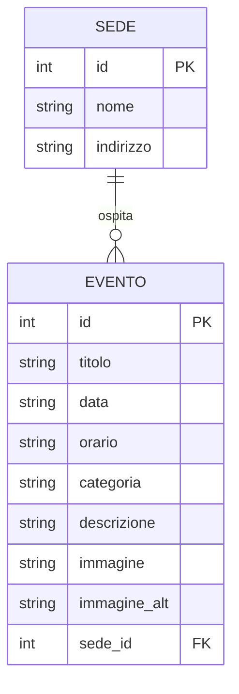

# Scheda dati — Segnale (Festival di design)

## 1. Entità
- **Evento**: un appuntamento del programma del festival (incontro, laboratorio o mostra), con data, orario, descrizione, immagine e riferimento alla sede[cite: 1, 4, 7].
- **Sede**: un luogo del festival a Torino, con nome e indirizzo[cite: 2, 3].

## 2. Campi di ciascuna entità

### Evento (`dati/eventi.json`)[cite: 1]
| Campo | Tipo | Esempio |
| :--- | :--- | :--- |
| `id` | `number` (intero) | `1`[cite: 1] |
| `titolo` | `string` | `"Lettere in movimento"`[cite: 1] |
| `data` | `string` (data ISO `YYYY-MM-DD`) | `"2026-06-12"`[cite: 1] |
| `orario` | `string` (`HH:MM`) | `"10:00"`[cite: 1] |
| `categoria` | `string` | `"Incontro"`[cite: 1] |
| `descrizione` | `string` | `"Come cambia un messaggio quando cambiano le lettere? Un incontro su tipografia, ritmo e comunicazione visiva."`[cite: 1] |
| `immagine` | `string` (percorso file) | `"assets/lettere-in-movimento.svg"`[cite: 1] |
| `immagine_alt` | `string` | `"Lettere geometriche disposte su una griglia"`[cite: 1] |
| `sede_id` | `number` (intero, chiave esterna verso `Sede.id`) | `1`[cite: 1] |

### Sede (`dati/sedi.json`)[cite: 2]
| Campo | Tipo | Esempio |
| :--- | :--- | :--- |
| `id` | `number` (intero) | `1`[cite: 2] |
| `nome` | `string` | `"Officina Nord — Sede centrale"`[cite: 2] |
| `indirizzo` | `string` | `"Corso Duca degli Abruzzi 24, Torino"`[cite: 2] |

## 3. Chiavi primarie
- **Evento**: `id` numerico, univoco all'interno di `eventi.json` e stabile (non è necessario che sia consecutivo)[cite: 1].
- **Sede**: `id` numerico, univoco all'interno di `sedi.json` e stabile[cite: 2].

## 4. Relazione
- Relazione **uno-a-molti (`1:N`)** tra **Sede** ed **Evento**: una sede può ospitare più eventi, mentre ogni evento si svolge in una sola sede.
- Il campo `Evento.sede_id` funge da chiave esterna e fa riferimento a `Sede.id` (nome e indirizzo della sede risiedono solo in `sedi.json` e vengono recuperati tramite `sede_id`).

## 5. Quantità
- **6 eventi** (distribuiti su due giornate, 12–13 giugno 2026)[cite: 1, 4].
- **3 sedi** a Torino[cite: 2, 3].

## 6. Chi aggiorna i dati e come
- I dati vengono aggiornati dai curatori/sviluppatori del progetto modificando direttamente i file `dati/eventi.json` e `dati/sedi.json` nella repository (verificando la validità della sintassi JSON e la coerenza dei `sede_id`) e pubblicando le modifiche tramite commit/push sulla repository e rilascio del sito[cite: 1, 2].

## 7. Che cosa mostra la pagina
- Nella pagina **Programma** (`programma.html`) vengono mostrati gli appuntamenti del festival con immagine e testo alternativo, data/orario/categoria, titolo, descrizione e sede di riferimento[cite: 4].
- Nelle pagine **Info e luoghi** (`info.html`) e **Home** (`index.html`) vengono presentate le sedi del festival (con indirizzi, mappa, indicazioni e galleria fotografica) e la panoramica generale delle due giornate[cite: 3, 7].

---

## Schema Evento–Sede

